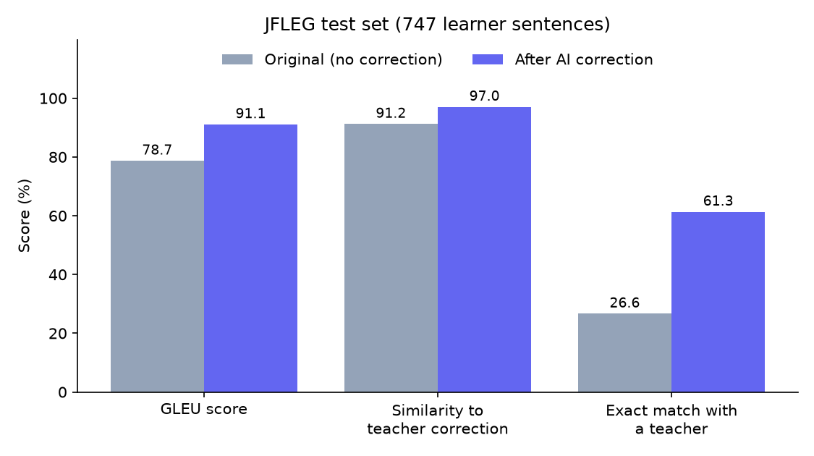
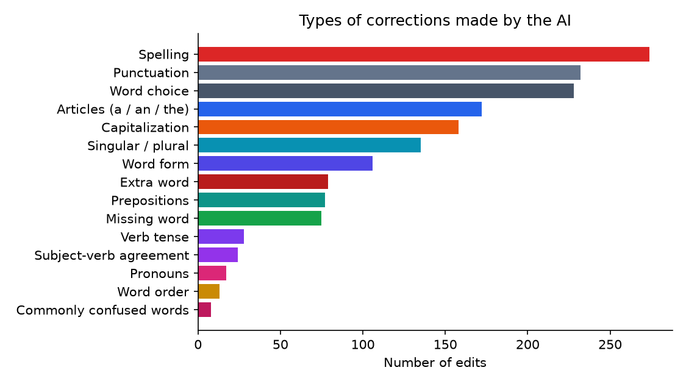

# ✍️ GrammarCoach: AI Grammar Fixer & Learning Tool

**Course:** Professional Training (YN3012170034), Mid-term Project
**Student:** ALHAMMADI NEHAL, Student ID 20243120040
**Folder:** `alh040`

GrammarCoach is an interactive web app that **corrects English grammar with a Transformer model and
teaches the learner *why* each correction was made**. Most grammar checkers only fix text. GrammarCoach
also explains every mistake, lets you practise on real learner sentences, and tracks which mistakes you
make most often.

---

## ✨ Features

| Tab | What it does |
|---|---|
| ✏️ **Fix My Writing** | Paste any English text. The AI corrects it, shows every change in colour (red = removed, green = added), labels the mistake type (verb tense, articles, spelling, etc.) and gives a mini grammar lesson for each fix. |
| 🎯 **Practice Quiz** | Shows a real sentence written by an English learner (JFLEG dataset). You correct it yourself and get a score out of 100 by comparison with 4 human teacher corrections, plus hints for what is still wrong. You can also compare your answer with the AI's. |
| 📊 **My Progress** | A chart of your most common mistake types during the session, your average quiz score, and recommendations on what to study next. |
| 🔬 **How It Works** | Explains the model and shows the evaluation results produced by `evaluate.py`. |

---

## 🧠 The Machine Learning Model

| | |
|---|---|
| **Model** | [`vennify/t5-base-grammar-correction`](https://huggingface.co/vennify/t5-base-grammar-correction) |
| **Architecture** | T5-base (Text-to-Text Transfer Transformer), an encoder-decoder Transformer with ≈220M parameters |
| **Base model** | Google's T5 (Raffel et al., 2020), pre-trained on the C4 web-text corpus |
| **Fine-tuned on** | JFLEG, English learner sentences with human corrections |
| **Task type** | Text-to-text generation (sequence-to-sequence) |

### How it works
1. **Tokenization:** the input sentence, prefixed with `grammar: `, is split into sub-word pieces
   (SentencePiece), each mapped to a number.
2. **Encoder:** 12 Transformer layers read the whole sentence at once. **Self-attention** lets each word
   look at every other word, so the model learns context (for example, *"Yesterday I go"*: *go* conflicts with *yesterday*).
3. **Decoder:** 12 Transformer layers generate the corrected sentence one token at a time. At each step,
   *cross-attention* looks back at the encoder's representation of the original sentence.
4. **Beam search (5 beams):** instead of greedily choosing one word at a time, the model keeps the 5 most
   probable partial sentences and returns the best complete one.

Grammar correction is treated like **translation from "incorrect English" to "correct English"**.

### The feedback engine (rule-based, `feedback.py`)
The model only outputs a corrected sentence. To turn this into learning feedback, the app:
1. aligns the original and corrected sentences word by word (Python `difflib`),
2. classifies each change with grammar rules (irregular-verb list, article/preposition/pronoun lists,
   plural endings, spelling similarity, commonly confused words, word-order detection),
3. attaches a short lesson for each of the 15 mistake categories.

### Capabilities
- Fixes common learner errors: verb tense, subject-verb agreement, articles, plurals, spelling,
  capitalization, prepositions and commonly confused words.
- Handles whole paragraphs (split into sentences automatically).
- Runs on a normal laptop CPU (about 0.5-2 seconds per sentence).

### Limitations
- **It can over-correct or miss errors.** It sometimes rewrites correct sentences or leaves mistakes.
- **Mistake labels are rule-based**, so they are a best guess and can be wrong for unusual edits
  (these fall back to "Word choice").
- **English only**, trained on short learner essays. Less reliable on long, technical or very informal text.
- Inputs longer than 128 sub-word tokens per sentence are truncated.
- The model's licence (CC BY-NC-SA 4.0) allows **non-commercial use only**.

---

## 📁 Project Structure

```
alh040/
├── app.py              # Gradio web interface (4 tabs)
├── grammar_model.py    # loads the T5 model and corrects text
├── feedback.py         # finds edits, classifies mistakes, builds lessons + coloured diff
├── quiz.py             # Practice Quiz: question bank (JFLEG validation split) + grading
├── progress.py         # tracks mistakes during a session + progress chart
├── metrics.py          # GLEU, exact match (evaluation metrics)
├── evaluate.py         # evaluates the model on the JFLEG test split -> results/
├── tests/
│   └── test_core.py    # unit tests (no model needed)
├── results/            # evaluation charts + metrics.json (created by evaluate.py)
├── requirements.txt
├── .gitignore
└── README.md
```

`data/` (quiz cache) and the downloaded model are **not** stored in the repository. They are
downloaded automatically.

---

## 🚀 Installation

**Requirements:** Python 3.10-3.12, about 2 GB of free disk space, and internet access the first time.

```bash
# 1. Go to the project folder
cd alh040

# 2. Create and activate a virtual environment
python -m venv venv
venv\Scripts\activate          # Windows
source venv/bin/activate       # macOS / Linux

# 3. Install the dependencies
pip install -r requirements.txt
```

### 🇨🇳 Running in mainland China
`huggingface.co` is blocked, so either turn on a VPN for the first run, **or** use the Hugging Face mirror
before running any script:

```bash
set HF_ENDPOINT=https://hf-mirror.com           # Windows (Command Prompt)
$env:HF_ENDPOINT="https://hf-mirror.com"        # Windows (PowerShell)
export HF_ENDPOINT=https://hf-mirror.com        # macOS / Linux
```

After the first run the model (≈900 MB) and dataset are cached, and the app works offline.

---

## ▶️ Usage

```bash
python app.py
```
Then open **http://127.0.0.1:7860** in your browser. The first start downloads the model, which takes a few minutes.

Quick command-line test of the model:
```bash
python grammar_model.py
```

### Evaluate the model
```bash
python evaluate.py              # all 748 JFLEG test sentences (about 5-15 min on CPU)
python evaluate.py --limit 100  # quick run
```
This creates `results/metrics.json`, `results/score_comparison.png`, `results/edit_categories.png` and
`results/examples.csv`. The results are then shown in the app's **How It Works** tab.

### Run the unit tests
```bash
python -m pytest tests/
```

---

## 📊 Evaluation Method

- **Dataset:** JFLEG **test** split (748 learner sentences, each with 4 human corrections). The quiz uses the
  separate **validation** split, so evaluation data is never shown in the quiz.
- **Baseline:** the original, uncorrected sentence. A useful model must score clearly higher than "doing nothing".
- **Metrics:**
  - **GLEU** (Wu et al., 2016): n-gram overlap (1-4 words) with the closest human correction, `min(precision, recall)`.
    *Note:* this differs slightly from the official JFLEG GLEU (Napoles et al., 2015), so the numbers are not
    directly comparable with published leaderboards.
  - **Similarity** to the closest teacher correction (word-level `difflib` ratio).
  - **Exact match** with any teacher correction.
  - The percentage of sentences **changed**, **improved** and **made worse**.

### Results (747 JFLEG test sentences, CPU)

| Metric | Original (no correction) | After AI correction |
|---|---|---|
| GLEU | 0.787 | **0.911** |
| Similarity to closest teacher correction | 91.2% | **97.0%** |
| Exact match with a teacher correction | 26.6% | **61.3%** |

- Sentences changed by the AI: **77.0%**. Improved: **62.1%**. Made worse: **7.4%**.
- The AI clearly outperforms the "no correction" baseline on every metric.
- **Caution:** the model was fine-tuned on JFLEG, so it may have seen similar (or the same) sentences
  during training. These scores may therefore be optimistic compared with completely new writing.




---

## 📚 Dataset

**JFLEG** (JHU FLuency-Extended GUG corpus), loaded from the Hugging Face Hub as
[`jhu-clsp/jfleg`](https://huggingface.co/datasets/jhu-clsp/jfleg). It has 1,503 sentences by English
learners, each corrected by 4 annotators, and is licensed CC BY-NC-SA 4.0. It is downloaded automatically, so
nothing needs to be added to the repository.

If the dataset cannot be downloaded, the quiz falls back to 12 built-in practice sentences written for this project.

---

## 📖 References

1. Raffel, C. et al. (2020). *Exploring the Limits of Transfer Learning with a Unified Text-to-Text Transformer.* JMLR 21(140).
2. Napoles, C., Sakaguchi, K., & Tetreault, J. (2017). *JFLEG: A Fluency Corpus and Benchmark for Grammatical Error Correction.* EACL 2017.
3. Vaswani, A. et al. (2017). *Attention Is All You Need.* NeurIPS 2017.
4. Wu, Y. et al. (2016). *Google's Neural Machine Translation System.* arXiv:1609.08144 (GLEU metric).
5. Napoles, C. et al. (2015). *Ground Truth for Grammatical Error Correction Metrics.* ACL 2015.
6. vennify. *t5-base-grammar-correction*, Hugging Face Model Hub.
7. Gradio: https://www.gradio.app · Hugging Face Transformers: https://huggingface.co/docs/transformers

## 🙏 Acknowledgements
The pre-trained model is by **vennify** (CC BY-NC-SA 4.0). The JFLEG dataset is by Napoles, Sakaguchi & Tetreault (CC BY-NC-SA 4.0).
This project is for non-commercial, educational use.
